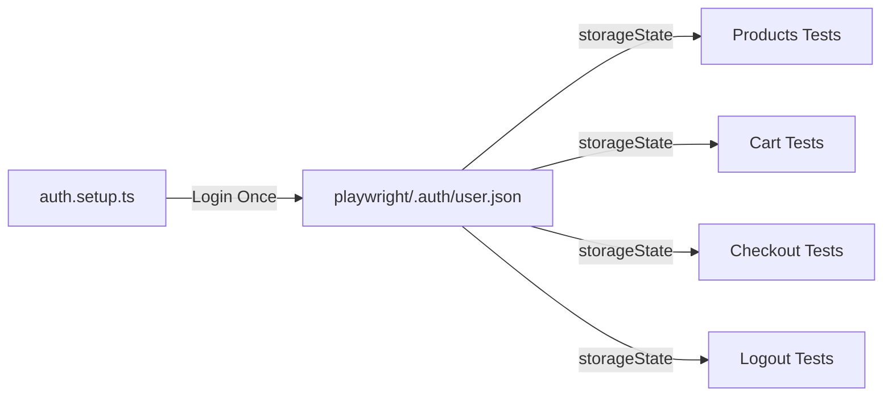
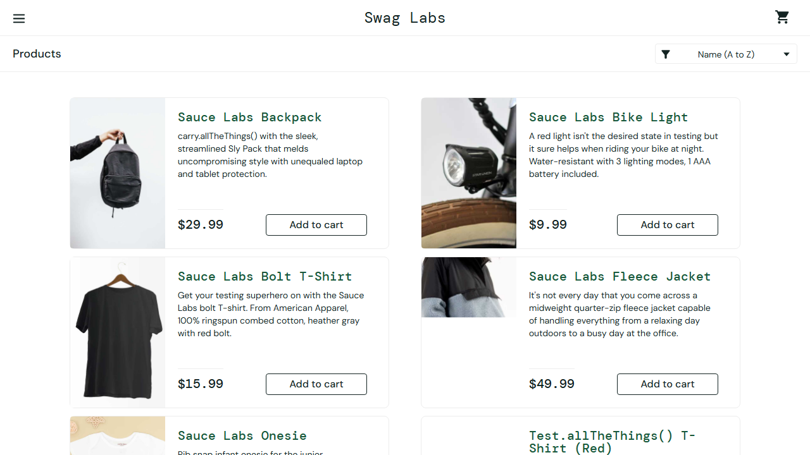
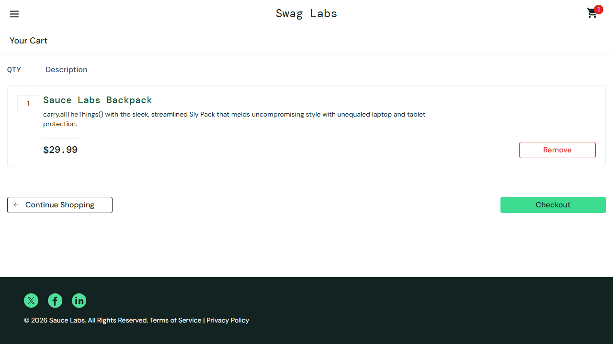

# Enterprise Playwright TypeScript Automation Framework 🎭

[](file:///.github/workflows/playwright.yml)
[](https://www.typescriptlang.org/)
[](https://playwright.dev/)
[](https://nodejs.org/)

An enterprise-grade End-to-End (E2E) Test Automation Framework designed by a Senior QA Automation Architect for the [SauceDemo](https://www.saucedemo.com/) e-commerce web application. Built with **Playwright**, **TypeScript**, and the **Page Object Model (POM)** pattern.

---

## 📑 Table of Contents

- [Architectural Overview](#-architectural-overview)
- [Directory Structure](#-directory-structure)
- [Design Pattern & Core Principles](#-design-pattern--core-principles)
- [Authentication Optimization (`storageState`)](#-authentication-optimization-storagestate)
- [Test Data Management](#-test-data-management)
- [Test Scenarios Matrix](#-test-scenarios-matrix)
- [Prerequisites & Installation](#-prerequisites--installation)
- [Execution Commands](#-execution-commands)
- [Reporting & Failure Artifacts](#-reporting--failure-artifacts)
- [CI/CD Pipeline](#-cicd-pipeline)
- [Sample Screenshots](#-sample-screenshots)

---

## 🏛️ Architectural Overview

This framework adheres strictly to enterprise test automation standards:
- **Language & Runtime**: TypeScript with strict mode enabled, executed on Node.js.
- **Test Runner**: Native `@playwright/test` test runner supporting multi-worker parallelism.
- **Design Pattern**: Page Object Model (POM) with a shared `BasePage` base class.
- **State Management**: Optimized authentication using Playwright's `storageState` to eliminate redundant logins.
- **Locator Strategy**: Prioritizes user-facing semantic locators (`getByRole`, `getByPlaceholder`, `getByText`, `data-test`) — zero fragile XPath.
- **Assertions**: 100% Web-First Auto-Retrying Assertions (`expect(locator).toBeVisible()`, `expect(page).toHaveURL()`). Zero arbitrary `page.waitForTimeout()` sleeps.
- **Test Data**: 100% externalized inside JSON files managed through strongly-typed reader interfaces.

---

## 📁 Directory Structure

```text
d:/Antigravity/
├── .github/
│   └── workflows/
│       └── playwright.yml         # GitHub Actions CI/CD pipeline
├── fixtures/
│   ├── baseFixture.ts             # Base fixture with unauthenticated page instances
│   └── loggedInFixture.ts         # Fixture reusing saved storageState session
├── pages/
│   ├── BasePage.ts                # Base Page class: header, menu, badges, navigations
│   ├── LoginPage.ts               # Login screen locators & actions
│   ├── ProductPage.ts             # Product inventory, catalog details & sorting
│   ├── CartPage.ts                # Cart item verification & removal
│   └── CheckoutPage.ts            # Step 1 (Info), Step 2 (Overview), Step 3 (Confirmation)
├── test-data/
│   ├── users.json                 # User personas & credential sets
│   ├── products.json              # Catalog items, descriptions, and sort configurations
│   └── checkoutData.json          # Customer datasets and order completion texts
├── tests/
│   ├── auth.setup.ts              # Global authentication setup creating storageState
│   ├── login/
│   │   └── login.spec.ts          # Authentication positive, negative & validation tests
│   ├── products/
│   │   └── products.spec.ts       # Catalog display, item details & sort variations
│   ├── cart/
│   │   └── cart.spec.ts           # Add/remove products & dynamic badge checks
│   ├── checkout/
│   │   └── checkout.spec.ts       # Full purchase workflow & mandatory fields validation
│   └── logout/
│       └── logout.spec.ts         # Logout flow & session invalidation verification
├── utils/
│   ├── constants.ts               # Global URLs, timeouts, sort options, and paths
│   ├── helper.ts                  # Price cleaners, sort validators, formatting utilities
│   ├── logger.ts                  # Structured timestamped console logger
│   └── testDataReader.ts          # Strongly typed reader utility for test data JSONs
├── reports/
│   ├── html-report/               # Interactive Playwright HTML Report
│   └── test-results.json          # Structured JSON test execution summary
├── screenshots/                   # Application screenshots and failure captures
├── playwright/
│   └── .auth/
│       └── user.json              # Serialized authentication state (cookies & localStorage)
├── playwright.config.ts           # Global Playwright configuration
├── tsconfig.json                  # TypeScript compiler settings
└── package.json                   # Dependencies, scripts & metadata
```

---

## 🎯 Design Pattern & Core Principles

### 1. Page Object Model (POM)
Every web page is modeled as a TypeScript class:
- **Centralized Locators**: Declared as `readonly Locator` fields initialized in the constructor.
- **Reusable Methods**: Actions are exposed as meaningful asynchronous functions (`login()`, `addProductToCartByName()`, `selectSortOption()`).
- **BasePage Inheritance**: Common headers, sidebar burger menu, shopping cart badges, and base navigation methods reside in `pages/BasePage.ts`.

### 2. Playwright Best Practices
- **Resilient Locators**: Elements are located using user-centric semantic queries (`getByRole('button', { name: 'Login' })`, `getByPlaceholder('Username')`, `locator('[data-test="..."]')`).
- **Web-First Assertions**: Auto-retrying assertions ensure tests never suffer from race conditions:
  ```typescript
  await expect(productPage.pageTitle).toHaveText('Products');
  await expect(page).toHaveURL(/.*inventory\.html/);
  ```
- **No Thread Sleeps**: Hardcoded `waitForTimeout` is prohibited. Synchronization is managed via Playwright's built-in event listeners and web-first locators.

---

## 🔐 Authentication Optimization (`storageState`)

Instead of repeating the UI login form flow before every single test:
1. **Global Auth Setup (`tests/auth.setup.ts`)**: Runs once as a project dependency in `playwright.config.ts`.
2. **Session Persistence**: Captures cookies and local storage to `playwright/.auth/user.json`.
3. **Session Reuse (`fixtures/loggedInFixture.ts`)**: Injects `storageState` into subsequent test contexts, navigating directly to `/inventory.html` authenticated.
4. **Smart Fallback**: If an engineer runs an isolated test file (e.g. `npm run test:products`) without running setup first, `loggedInFixture.ts` automatically detects the missing file, authenticates once on the fly, persists the state, and continues without failure.



---

## 📊 Test Data Management

All test data is isolated from test logic in the `test-data/` folder:
- **`users.json`**: Standard users, locked users, invalid credentials, and boundary validation messages.
- **`products.json`**: Complete product inventory, exact descriptions, prices, and dropdown sorting keys.
- **`checkoutData.json`**: Customer checkout profiles, missing field error strings, and order completion texts.

Access is mediated through the strongly typed `TestDataReader` class:
```typescript
const standardUser = TestDataReader.getStandardUser();
const expectedProducts = TestDataReader.getProductItems();
```

---

## 🧪 Test Scenarios Matrix

| Module | Test ID | Description | Fixture |
| :--- | :--- | :--- | :--- |
| **Login** | `TC_LOGIN_001` | Login with valid credentials (`standard_user`) | `baseFixture` |
| **Login** | `TC_LOGIN_002` | Login with locked-out user & verify error banner | `baseFixture` |
| **Login** | `TC_LOGIN_003` | Login with invalid password & verify error banner | `baseFixture` |
| **Login** | `TC_LOGIN_004` | Verify mandatory validation on empty credentials | `baseFixture` |
| **Login** | `TC_LOGIN_005` | Verify successful navigation to inventory after login | `baseFixture` |
| **Products** | `TC_PROD_001` | Verify all 6 products displayed with title, desc & price | `loggedInFixture` |
| **Products** | `TC_PROD_002` | Verify product details match test data catalogue | `loggedInFixture` |
| **Products** | `TC_PROD_003` | Verify sorting Price: Low to High | `loggedInFixture` |
| **Products** | `TC_PROD_004` | Verify sorting Price: High to Low | `loggedInFixture` |
| **Products** | `TC_PROD_005` | Verify sorting Name: A to Z | `loggedInFixture` |
| **Products** | `TC_PROD_006` | Verify sorting Name: Z to A | `loggedInFixture` |
| **Cart** | `TC_CART_001` | Add single product to cart & verify badge | `loggedInFixture` |
| **Cart** | `TC_CART_002` | Add multiple products to cart & verify count | `loggedInFixture` |
| **Cart** | `TC_CART_003` | Remove product from cart & verify list is empty | `loggedInFixture` |
| **Cart** | `TC_CART_004` | Verify cart badge dynamic increment & decrement | `loggedInFixture` |
| **Cart** | `TC_CART_005` | Verify cart item specifications match added item | `loggedInFixture` |
| **Checkout** | `TC_CHECKOUT_001` | Complete full checkout flow successfully | `loggedInFixture` |
| **Checkout** | `TC_CHECKOUT_002` | Verify order confirmation header & subtext message | `loggedInFixture` |
| **Checkout** | `TC_CHECKOUT_003` | Validate mandatory customer fields (First, Last, Zip) | `loggedInFixture` |
| **Checkout** | `TC_CHECKOUT_004` | Cancel checkout process from Step 1 and Step 2 | `loggedInFixture` |
| **Logout** | `TC_LOGOUT_001` | Logout successfully via sidebar navigation menu | `loggedInFixture` |
| **Logout** | `TC_LOGOUT_002` | Verify redirect to login page & access denial to inventory | `loggedInFixture` |

---

## ⚡ Prerequisites & Installation

### 1. Prerequisites
- **Node.js**: v18.0.0 or higher (v20+ recommended)
- **NPM**: v9.0.0 or higher

### 2. Installation
Clone the repository and install dependencies:
```bash
# Clone the repository
git clone https://github.com/your-username/saucedemo-playwright-framework.git
cd saucedemo-playwright-framework

# Install Node dependencies
npm install

# Install Playwright browser binaries
npx playwright install --with-deps chromium
```

---

## 🚀 Execution Commands

| Command | Description |
| :--- | :--- |
| `npm test` | Runs all test suites on Chromium with storageState optimization |
| `npm run test:login` | Runs Login module tests |
| `npm run test:products` | Runs Product Catalogue & Sorting module tests |
| `npm run test:cart` | Runs Shopping Cart module tests |
| `npm run test:checkout` | Runs Checkout module tests |
| `npm run test:logout` | Runs Logout module tests |
| `npm run test:headed` | Runs tests with browser UI visible on screen |
| `npm run test:parallel` | Runs tests with 4 parallel worker threads |
| `npm run test:all-browsers` | Runs full test matrix across Chromium, Firefox, and WebKit |
| `npm run test:ui` | Opens the interactive Playwright UI Runner |
| `npm run test:debug` | Runs tests in step-by-step debug mode with Playwright Inspector |
| `npm run test:report` | Opens the interactive HTML report in default browser |
| `npm run typecheck` | Validates TypeScript types across the entire project |

---

## 📈 Reporting & Failure Artifacts

The framework produces multi-format test reporting configured in `playwright.config.ts`:

1. **HTML Report**: Comprehensive interactive report stored in `reports/html-report/`.
   ```bash
   npm run test:report
   ```
2. **JSON Summary**: Structured test results output to `reports/test-results.json`.
3. **Failure Artifacts**:
   - **Screenshots**: Automatically captured on test failure (`screenshot: 'only-on-failure'`).
   - **Videos**: Recorded and retained upon failure (`video: 'retain-on-failure'`).
   - **Traces**: Full step-by-step network, action, and DOM snapshots (`trace: 'retain-on-failure'`).

To view a saved trace archive:
```bash
npx playwright show-trace test-results/<test-folder>/trace.zip
```

---

## 🔄 CI/CD Pipeline

The framework includes a production-ready GitHub Actions workflow in `.github/workflows/playwright.yml`:
- Triggers on `push` and `pull_request` against `main` / `master` branches, plus manual `workflow_dispatch`.
- Sets up Node.js with caching.
- Installs dependencies and Playwright browser binaries.
- Executes tests in parallel.
- Generates and uploads the HTML test report as an artifact accessible for 14 days.
- Uploads failure screenshots and traces when failures occur.

---

## 📸 Sample Screenshots

| Screen | Description | Preview |
| :--- | :--- | :--- |
| **Login Screen** | Authentication page with credential inputs |  |
| **Product Catalogue** | Inventory listing with sort dropdown & cart actions |  |
| **Shopping Cart** | Cart review page with quantity & item details |  |
| **Checkout Flow** | Customer shipping info & payment overview |  |

---

## 👨‍💻 Author & Best Practices Reference

Maintained by **Senior QA Automation Architect**. Built according to official [Playwright Best Practices](https://playwright.dev/docs/best-practices).
